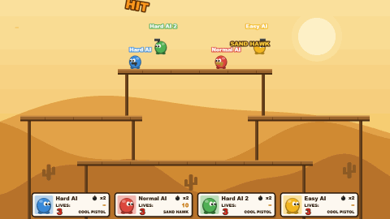
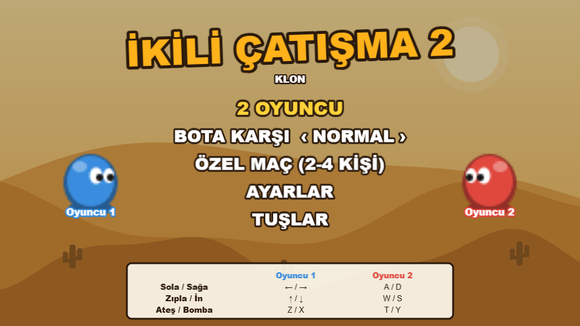
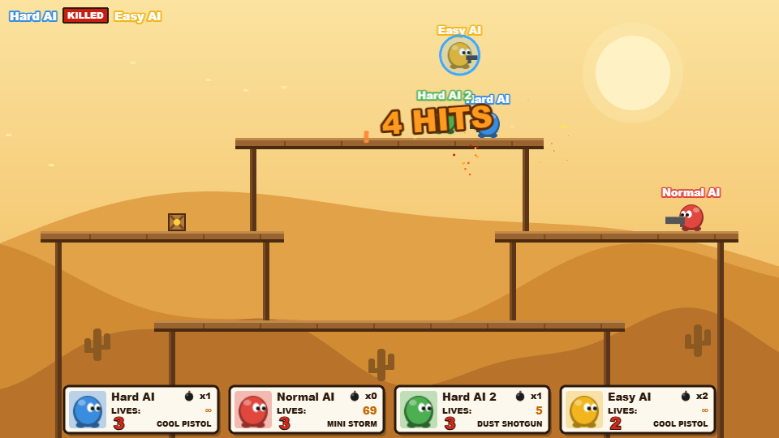
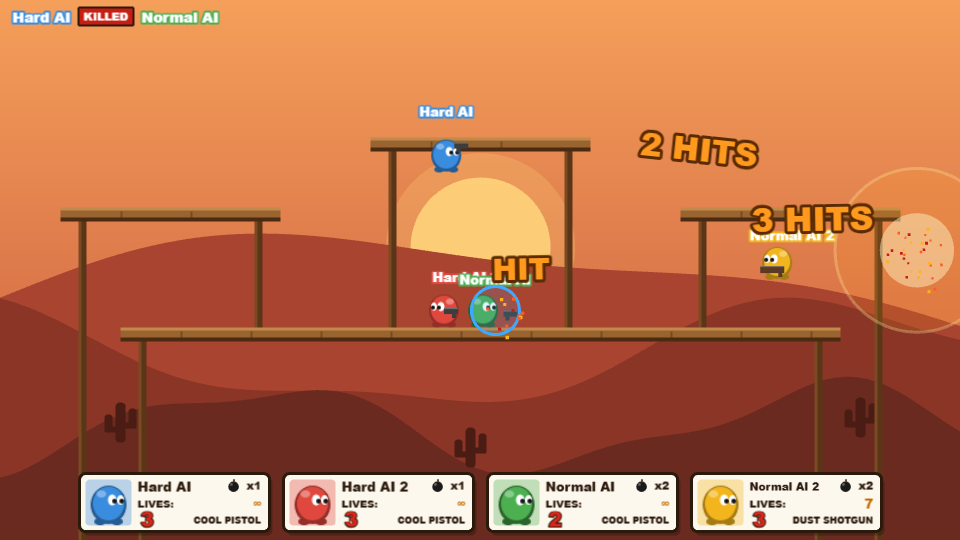
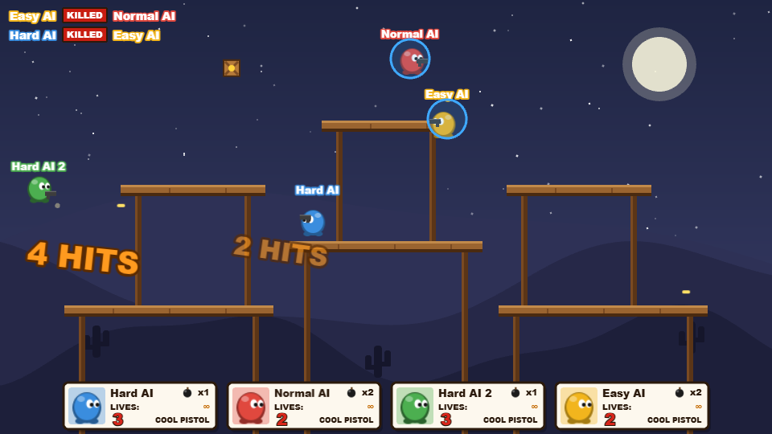
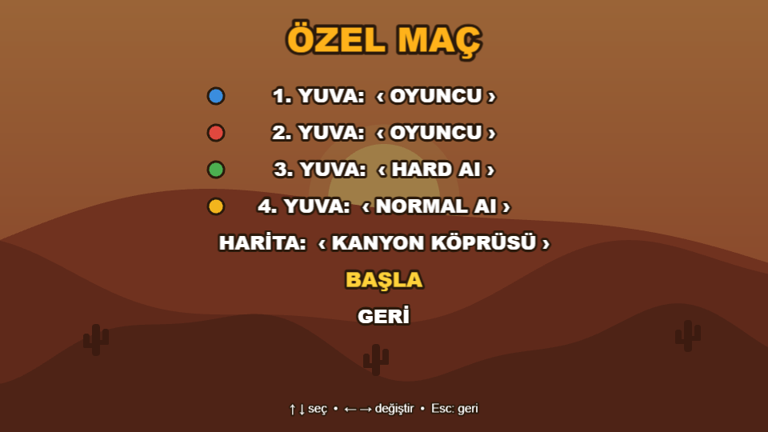
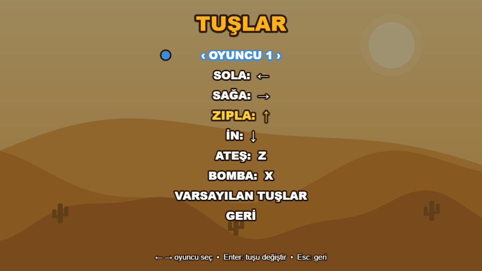

<div align="center">

# İkili Çatışma 2 — Klon

**Aynı klavyede 2-4 kişilik, silahlı 2D platform dövüş oyunu.**
Rakibini vur, savur, masadan aşağı at. Son ayakta kalan kazanır.




</div>

---

## İçindekiler

- [Özellikler](#özellikler)
- [Ekran görüntüleri](#ekran-görüntüleri)
- [Kurulum ve çalıştırma](#kurulum-ve-çalıştırma)
- [Nasıl oynanır](#nasıl-oynanır)
- [Kontroller](#kontroller)
- [Silahlar](#silahlar)
- [Haritalar](#haritalar)
- [Botlar](#botlar)
- [Proje yapısı](#proje-yapısı)
- [Yeni silah veya harita eklemek](#yeni-silah-veya-harita-eklemek)
- [Yol haritası](#yol-haritası)
- [Not](#not)

## Özellikler

- **2-4 oyuncu, tek klavye**: her yuva insan, bot ya da kapalı olabilir
- **Easy / Normal / Hard botlar**: masalar arası yol bulur, nişan alır, kutu toplar, bombadan kaçar, kenardan kurtulmaya çalışır
- **7 silah**: pistol, tabanca, makineli, pompalı, keskin nişancı, minigun ve patlayan roketatar
- **Bomba**: sekerek gider, kısa süre sonra patlar, yakındaki herkesi savurur
- **Can yerine savrulma**: mermi can götürmez, geri iter; boşluğa düşen 1 can kaybeder
- **3 harita**: gündüz çölü, gün batımı kanyonu ve yıldızlı gece kuleleri
- **Combo ve kill feed**: `HIT`, `2 HITS`, `3 HITS`... ve sol üstte `[Katil] KILLED [Ölen]`
- **Menüler**: ana menü, özel maç kurulumu, ayarlar ve tuş atama ekranı; seçimler tarayıcıda saklanır
- **Tüm görseller kodla çizilir**: oyunda hiçbir resim ya da ses dosyası yok

## Ekran görüntüleri

| Ana menü | Çöl Masaları |
|:---:|:---:|
|  |  |
| **Kanyon Köprüsü** | **Gece Kuleleri** |
|  |  |
| **Özel maç** | **Tuş atama** |
|  |  |

## Kurulum ve çalıştırma

Gereken: [Node.js](https://nodejs.org) 20.19 veya üstü (22+ önerilir).

```bash
git clone https://github.com/alibaykara1/ikili-at-ma2.git
cd ikili-at-ma2
npm install
npm run dev
```

Tarayıcıda `http://localhost:5173` adresini aç.

| Komut | Ne yapar |
|---|---|
| `npm run dev` | Geliştirme sunucusunu başlatır (kaydettikçe yenilenir) |
| `npm run build` | Yayınlanabilir dosyaları `dist/` klasörüne üretir |
| `npm run preview` | `dist/` çıktısını yerelde açar |

## Nasıl oynanır

1. Ana menüden **2 OYUNCU**, **BOTA KARŞI** ya da **ÖZEL MAÇ (2-4 KİŞİ)** seç.
2. Rakiplerini ateş ve bombayla vurup masaların kenarından aşağı it.
3. Ekranın altına düşen 1 can kaybeder ve üstte, mavi bir kalkanla kısa süre dokunulmaz olarak yeniden doğar.
4. Son canında `LAST LIFE` yazısı çıkar. Canı biten elenir, **son kalan kazanır**.

İpuçları:
- Mermi yiyen savaşçı kısa bir an yürüyemez ama **zıplayabilir**. Ateşin üstüne yürümek yerine zıplayıp mermilerin üstünden geç ya da aşağı in.
- Havadayken savrulma daha uzun sürer. Rakibi zıplarken vurmak onu en uzağa atar.
- Masalardan aşağıdan geçilir, **aşağı** tuşuyla bulunduğun masadan inersin. Havada bir kez daha zıplayabilirsin.
- Yukarıdan düşen tahta kutular rastgele bir silah verir. Mermisi biten silah Cool Pistol'a döner.

## Kontroller

| Eylem | Oyuncu 1 | Oyuncu 2 | Oyuncu 3 | Oyuncu 4 |
|---|:---:|:---:|:---:|:---:|
| Sola / Sağa | ← / → | A / D | J / L | Num 4 / Num 6 |
| Zıpla | ↑ | W | I | Num 8 |
| Masadan in | ↓ | S | K | Num 5 |
| Ateş | Z | T | U | Num 7 |
| Bomba | X | Y | O | Num 9 |

Tüm tuşlar ana menüdeki **TUŞLAR** ekranından değiştirilebilir. Seçilen tuş başka bir yerde kullanılıyorsa iki tuş yer değiştirir.

| Oyun içi | |
|---|---|
| `Esc` | Ana menüye dön |
| `R` | Maç bitince tekrar oyna |
| `F1` | Fizik kutularını göster/gizle (geliştirici) |

## Silahlar

Başlangıç silahı Cool Pistol'dur. Diğerleri yukarıdan düşen kutulardan çıkar.

| Silah | Mermi | Atış / sn | İtiş | Özellik |
|---|:---:|:---:|:---:|---|
| **Cool Pistol** | ∞ | 3.6 | 260 | Başlangıç silahı |
| **Sand Hawk** | 10 | 1.9 | 520 | Ağır tabanca, güçlü geri tepme |
| **Rapid Fire** | 60 | 13 | 80 | Makineli, hafif sapma |
| **Dust Shotgun** | 8 | 1.3 | 5 × 170 | Tek atışta 5 saçma, kısa menzil |
| **Long Shot** | 5 | 0.9 | 760 | Keskin nişancı, çok hızlı mermi |
| **Mini Storm** | 120 | 22 | 50 | Minigun, mermi yağmuru |
| **Boom Tube** | 4 | 1.1 | patlama | Değdiği yerde ya da menzil sonunda patlayan roket |

Her savaşçının her canında 2 bombası vardır (ayarlardan 0-5 arası değişir).

## Haritalar

| Harita | Tema | Düzen |
|---|---|---|
| **Çöl Masaları** | Gündüz | 3 katlı masalar: üstte bir, ortada iki, altta uzun bir masa |
| **Kanyon Köprüsü** | Gün batımı | Uzun bir köprü, iki yan balkon ve ortada yüksek bir tepe |
| **Gece Kuleleri** | Yıldızlı gece | Altı küçük masadan oluşan iki kule ve ortada bir zirve |

Harita **ÖZEL MAÇ** ekranından seçilir; hızlı modlar son seçilen haritayı kullanır.

## Botlar

| Seviye | Tepki | Nişan | Davranış |
|---|---|---|---|
| **Easy** | Yavaş | Sık ıskalar | Kenarlara dikkatsiz, düşünce her zaman kurtulmaya çalışmaz, nadiren bomba atar |
| **Normal** | Orta | İyi | Bombadan kaçar, kutu toplar, kalkanlı rakibe mermi harcamaz |
| **Hard** | Hızlı | Çok iyi | Rakibine daha yakın dövüşür, bombayı daha sık atar, her düşüşte kurtulmaya çalışır |

Botlar masalar arasındaki geçişleri (zıpla / aşağı in / kenardan yürü) bir grafik olarak çıkarıp en kısa yolu bulur. Bu sayede yeni haritalarda da ek ayar gerekmeden çalışırlar.

## Proje yapısı

```
├── index.html
├── src/
│   ├── main.js             # Phaser oyununu ve sahneleri başlatır
│   ├── config.js           # Ayarlanabilir tüm sabitler (hız, zıplama, savrulma, bot seviyeleri...)
│   ├── weapons.js          # Silahlar (veri olarak)
│   ├── maps.js             # Haritalar (veri olarak)
│   ├── settings.js         # Oyuncu ayarları, tarayıcıda saklanır
│   ├── Player.js           # Savaşçı: hareket, zıplama, ateş, savrulma, can
│   ├── controllers.js      # Klavye girdisi
│   ├── Bot.js              # Bot yapay zekası
│   ├── Bombs.js            # Bomba ve patlamalar
│   ├── Crates.js           # Silah kutuları
│   ├── HUD.js              # Alttaki oyuncu kartları
│   ├── KillFeed.js         # Sol üstteki öldürme listesi
│   ├── background.js       # Haritaya göre arka plan çizimi
│   ├── ui.js               # Menü listesi ve ortak arayüz parçaları
│   └── scenes/
│       ├── MenuScene.js     # Ana menü
│       ├── MatchScene.js    # Özel maç kurulumu
│       ├── SettingsScene.js # Ayarlar
│       ├── ControlsScene.js # Tuş atama
│       └── GameScene.js     # Oyunun kendisi
└── docs/screenshots/       # README görselleri
```

## Yeni silah veya harita eklemek

Silahlar ve haritalar düz veridir, kod değiştirmeden eklenebilir.

**Silah** — [`src/weapons.js`](src/weapons.js) içine yeni bir kayıt ekle. `inCrates: true` ise kutulardan çıkar:

```js
laserPistol: {
  id: 'laserPistol',
  name: 'Laser Pistol',
  fireRate: 200,        // iki atış arası ms
  bulletSpeed: 1400,    // px/sn
  knockback: 300,       // vurulanı savurma hızı
  ammo: 15,
  recoil: 30,
  spread: 0,            // sapma (derece)
  pellets: 1,           // bir atıştaki mermi sayısı
  range: 2000,          // menzil (px)
  inCrates: true,
  bulletColor: 0xff3bd1,
  bulletSize: { w: 14, h: 3 },
  gun: { color: 0x7a2a8a, length: 16, height: 6 },
},
```

**Harita** — [`src/maps.js`](src/maps.js) içine masaları (`platforms`), 4 doğma noktasını (`spawns`), yeniden doğma noktalarını (`respawnPoints`) ve renk temasını (`theme`) ekle. Masa bacakları otomatik çizilir, botlar yolu kendileri bulur. Yeni harita özel maç ekranında hemen görünür.

## Yol haritası

- [ ] Ses efektleri ve müzik
- [ ] Karakter şapkaları ve görünüm seçimi
- [ ] Daha fazla silah ve harita
- [ ] Gamepad desteği

## Not

Bu proje, Flash oyunu **Gun Mayhem 2**'den (Türkiye'de *İkili Çatışma 2* adıyla bilinir) esinlenerek sıfırdan yazılmış, resmi olmayan bir hayran yapımıdır. Orijinal oyunun hiçbir görsel, ses ya da kod dosyasını içermez; oyundaki tüm görseller [Phaser](https://phaser.io) ile kodla çizilir.
